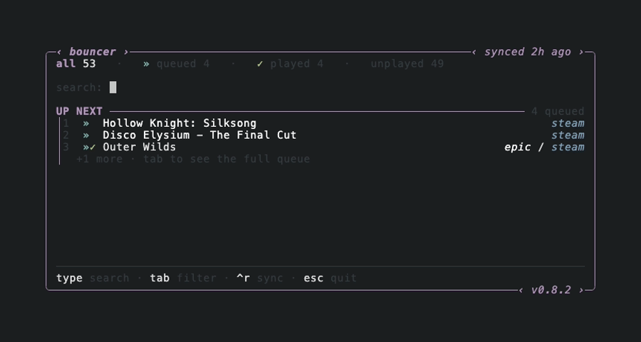
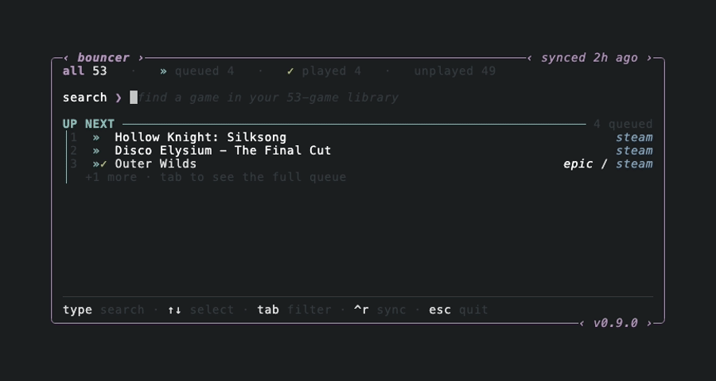

# bouncer

Wrangles your sprawling game library and keeps your shopping sprees in check.

Type a few letters and it finds the game across Steam, Epic, GOG, and Amazon,
no matter which launcher owns it, then queue up what you mean to play next.


-lightgrey)




## Setup

```sh
cargo install --path .
bouncer setup
```

The `setup` command prompts for your
[Steam API key](https://steamcommunity.com/dev/apikey) and your Steam profile
URL or vanity name (e.g. `https://steamcommunity.com/id/yourname` or just
`yourname`). It resolves the vanity name to a Steam ID automatically and stores
credentials in `~/.config/bouncer/config.json`.

It also asks for an optional
[IsThereAnyDeal API key](https://isthereanydeal.com/apps/my/), which `bouncer price`
and `bouncer cart` need. Press Enter to skip it and rerun `setup` later to add it.

## Usage

Run `bouncer` with no arguments for the interactive TUI. Everything else is a
plain command whose output pipes cleanly (no color).

### Search

Fuzzy, typo-tolerant, and indifferent to `™` and `®`. `»` marks a queued game
and `✓` a played one.

```console
$ bouncer hollow
   Hollow Knight            steam
»  Hollow Knight: Silksong  steam
   Mina the Hollower        epic

$ bouncer spirtfarer
   Spiritfarer®: Farewell Edition  steam
```

`bouncer search "..."` is the explicit form, for titles that collide with a
command name like "queue".

### Queue

Print your ranked queue:

```console
$ bouncer queue
 1   Hollow Knight: Silksong        steam
 2   Disco Elysium - The Final Cut  steam
 3 ✓ Outer Wilds                    epic / steam
 4   Pentiment                      gog
```

### Prices

Current and all-time-low prices from IsThereAnyDeal. Pass titles, Steam store
URLs, Steam app IDs, or IsThereAnyDeal game IDs. Prices are fetched fresh on
every run, so yours will differ from this example:

```console
$ bouncer price "hades ii" "outer wilds" https://store.steampowered.com/app/1145360
Title        Steam        Best now               All-time low
Hades II     $20.99 -30%  $20.99 -30% Steam      $20.99 Steam 2026-06-25
Outer Wilds  $12.49 -50%  $9.75 -61% GameBillet  $9.75 GameBillet 2026-10-31
Hades        $6.24 -75%   $6.24 -75% Steam       $6.24 Steam 2025-09-17
```

### Steam cart

Checks every item in your Steam cart against your library (on any platform)
and its all-time low, so you can prune the cart before checkout. Bundles are
priced as Steam prices them for you: games you already own on Steam drop out
of the bundle and out of the comparison.

Steam only exposes the cart to your logged-in store session, so this needs
that session's token, piped in and never saved. While logged in, open
<https://store.steampowered.com/pointssummary/ajaxgetasyncconfig>, copy the
`webapi_token` value, then:

```console
$ pbpaste | bouncer cart
Item                                 Cart    All-time low
Prince of Persia New Era (bundle)    $8.09   $8.99 Steam 2026-06-25       at low
  The Rogue Prince of Persia                 $8.99 Steam 2026-06-25
  Prince of Persia The Lost Crown                                         owned on steam, excluded
Detroit: Become Human                $3.99   $3.64 AllYouPlay 2025-12-24  above low
Hades II                             $20.99  $20.99 Steam 2026-06-25      at low
Felix the Reaper                     $0.99   $0.50 Gamer Thor 2024-11-11  already owned (epic)
...

Cart total          $142.16
At best prices now  $129.83
At all-time lows    $119.78
```

The totals price every item at Steam's cart price, at the cheapest store
selling it today, and at its all-time low. Items with no known price are
left out of a total, and the total says how many.

The token gives full access to your Steam account until it expires, so treat
it like a password.

### Sync

Refresh library caches from all sources. `-v` lists the titles added and
removed:

```console
$ bouncer sync -v
Syncing libraries...
  epic: 697 games (+2 -0)
    + Control
    + Tacoma
  gog: 194 games (+0 -0)
  amazon: 184 games (+0 -0)
  steam: 559 games (+0 -0)
Done.
```

`bouncer --version` prints the installed version.

## Sources

- **Steam** via the Web API (requires API key)
- **Epic / GOG / Amazon** via Heroic launcher's local library files

## Queue

Mark games as queued (want to play soon) or played from the TUI, then
filter and reorder the list.



 Queue state lives in
`~/.local/share/bouncer/queue.json`. If that file can't be read or parsed,
bouncer says so and stops saving rather than overwriting it, so a bad
hand-edit never costs you the queue.

| Key | Action |
| --- | --- |
| `Enter` | Toggle queued on the selected game |
| `Ctrl+P` | Toggle played on the selected game |
| `Tab` / `Shift+Tab` | Cycle filter: all, queued, played, unplayed |
| `Ctrl+J` / `Ctrl+K` (or `Shift+↓` / `Shift+↑`) | Move the selected game down / up in rank (queued filter only) |
| `Ctrl+R` | Force-sync libraries |
| `Esc` | Quit |

## Development

```sh
cargo build
cargo test
cargo run
```

This repo also ships two Claude Code skills for working on it visually:
`mockup`, for comparing ANSI mockups of a design change before
implementing it, and `live-preview`, for popping the freshly built binary
open in a real tmux window once a feature is done. Both come from the
`tui-utils` plugin:

```
/plugin marketplace add jeffdt/tui-utils
/plugin install tui-utils@tui-utils
```
